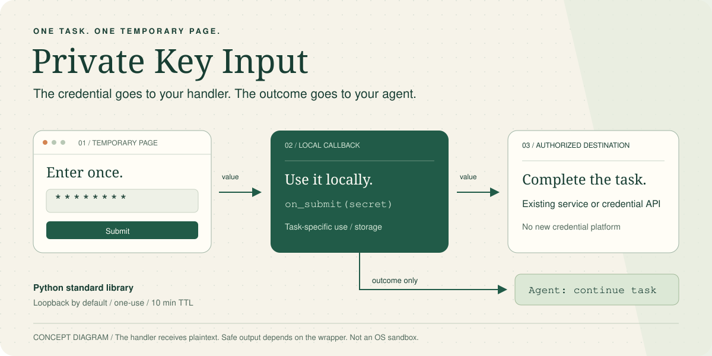

<div align="center">

# Private Key Input

**Give a local agent a credential without pasting it into chat.**

A short-lived HTML page hands the value to a task-specific local callback. The agent sees only the outcome and can continue the original task.

[简体中文](README.zh-CN.md) · [Quick start](#quick-start) · [Ask your agent](#ask-your-agent) · [Security model](#security-model)

  [](LICENSE)

</div>



*Concept diagram, not a product screenshot. The handler receives plaintext; only the outcome returns to the agent.*

## Why

Credentials pasted into chat can enter conversation history and model context. Private Key Input gives agent workflows a smaller path:

```text
You -> temporary page -> local callback -> authorized destination
                            |
                       outcome only -> agent continues
```

- **One task, one page.** A random route expires after ten minutes by default and closes after one accepted submission.
- **No credential platform.** The implementation uses only Python's standard library; there is no daemon, database, plugin, or new vault.
- **Outcome-only continuation.** The callback consumes the value locally while the host receives `submitted`, `expired`, or `handler_failed`.
- **Explicit network boundary.** Loopback is the default. Plaintext LAN access requires an explicit opt-in; TLS can be supplied by the caller.

> [!IMPORTANT]
> This is not a password vault or an OS sandbox. The local callback and destination necessarily receive plaintext. Keeping the value out of agent-visible output also depends on the task wrapper not printing, returning, or logging it.

<a id="quick-start"></a>
## Quick start

### 1. Install as a skill

Requires Python 3.9+ and a client that supports `SKILL.md` skills. No third-party Python package is required.

For a default Hermes profile:

```bash
git clone https://github.com/Loveacup/private-key-input.git ~/.hermes/skills/private-key-input
python3 -B -m unittest discover -s ~/.hermes/skills/private-key-input/scripts -p 'test_*.py'
```

A successful check ends with:

```text
Ran 6 tests

OK
```

The target directory must not already exist. Other clients should use their actual supported skill directory rather than copying the Hermes path. Installing the files does not start a listener, store a credential, or change client configuration.

### 2. Try the discard-only demo

Enter the directory installed above (use your actual checkout path if different):

```bash
cd ~/.hermes/skills/private-key-input
python3 -B examples/discard_demo.py
```

Windows users can run `py -B examples/discard_demo.py` when `python3` is unavailable.

The command prints a loopback URL and waits for up to ten minutes. Open it in a browser on the same machine, enter **test text only**, and submit. The callback discards the value; the terminal finishes with:

```text
Outcome: submitted
```

Do not use a real credential in this demo.

<a id="ask-your-agent"></a>
## Ask your agent

Once this repository is installed as a skill, use a request like:

> Use private-key-input for the credential required by this task. Resolve the authorized destination first, provide a temporary page, keep the value out of chat and tool output, and continue automatically after submission using an existing host mechanism. Do not add a callback service or store the secret somewhere new without authorization.

The operational contract is in [`SKILL.md`](SKILL.md). It tells the agent when to use this flow, how to deliver the page, how to continue without a second “done” message, and when to prefer the host's protected credential vault.

## Integrate it

Import `InputServer` or `serve` from [`scripts/private_input.py`](scripts/private_input.py). Run this discard-only example from the repository root; for a real task, the wrapper supplies a callback for the already-authorized destination:

```python
import sys
from pathlib import Path

sys.path.insert(0, str(Path("scripts").resolve()))
from private_input import serve


def accept(secret):
    return None  # Discard-only example; use test text.


serve(accept, purpose="Demo: input is discarded; use test text only.")
```

For real tasks, use the destination's existing credential API and extend the callback rather than the generic page. The callback should return `None`. It must not print or return the value, request headers, response bodies, or raw exceptions. Credential-bearing network requests should set a timeout and reject redirects.

### Host continuation

`serve(...)` prints the URL, waits for the page, and then prints the outcome. `InputServer(...)` exposes `url` and `run()` when the host needs to deliver the link separately.

- A terminal can normally show flushed output before the call finishes. Some agent tools buffer output until process exit; verify link delivery before depending on synchronous waiting.
- A buffered host should start the task-owned temporary process, deliver its URL, and wait through an existing completion mechanism—not add a permanent callback service.
- Return only the nonsecret outcome to the original conversation. Native continuation should not require the user to send a separate “done” message.

<a id="security-model"></a>
## Security model

### What the helper does

- Listens on `127.0.0.1` by default and selects an available port.
- Uses random page and submission tokens.
- Validates the route, `Host`, `Origin`, content type, body size, and submission token.
- Sends no-store, no-referrer, CSP, frame-denial, and content-type protection headers.
- Suppresses HTTP access logs and request-processing tracebacks.
- Closes after one accepted submission, callback failure, or waiting expiry; the host owns process cancellation.

### What the caller still owns

- Delivering the URL to the human before waiting blocks.
- Using the secret only for the already-authorized destination.
- Preventing plaintext from reaching logs, shell arguments, source code, status files, or agent output.
- Checking destination state before retrying `handler_failed`; the callback may have partially completed.
- Using the host credential-vault flow for browser passwords, login forms, and 2FA when one is available.

### LAN and TLS

Loopback URLs work only on the machine running the server. For a different device, provide a reachable `public_origin`.

- Prefer an existing trusted HTTPS route.
- For TLS, pass an `ssl.SSLContext` as `tls_context` and a matching bare HTTPS `public_origin`.
- Without TLS, `allow_plain_lan=True` is required. HTTP remains plaintext even on a private network and should be used only after informed consent.

The page defaults to Simplified Chinese. The password field includes standard autofill hints, but 1Password integration has not been established. The page never auto-submits a password-manager-filled value.

This is not a security audit and does not guarantee safety on a compromised host, memory zeroization, or hard callback deadlines. The default `ttl=600` is a waiting deadline, not a callback execution limit.

<details>
<summary>Options and outcomes</summary>

`InputServer(callback, purpose, host="127.0.0.1", port=0, ttl=600, allow_plain_lan=False, tls_context=None, public_origin=None)`

- `port=0`: select an available port.
- `submitted`: the callback returned; this does not establish downstream authentication.
- `expired`: the waiting deadline elapsed.
- `handler_failed`: the callback raised; check for partial completion before retrying.

</details>

## Verification

The repository's six tests cover:

- HTML page retrieval and one-time submission;
- expiry and listener closure;
- wrong route, Origin, and token rejection;
- explicit plaintext-LAN consent;
- callback failure without reflecting the submitted value.

The Python helper and short synchronous continuation were also exercised on macOS and Windows with independent loopback HTTP clients. That host experiment demonstrated same-conversation continuation after a synthetic submission; it is not part of the bundled unit suite.

Not established: browser rendering/JavaScript end to end, human-facing link delivery in every CLI, password-manager filling, real downstream authentication, LAN/TLS integration, long waits, detached wake-up, or recovery after session replacement.

## Project layout

```text
.
├── SKILL.md                     # Agent workflow and boundaries
├── examples/discard_demo.py     # Test-text-only browser demo
└── scripts/
    ├── private_input.py         # Standard-library HTTP helper
    └── test_private_input.py    # Six unit tests
```

## License

[MIT](LICENSE)
